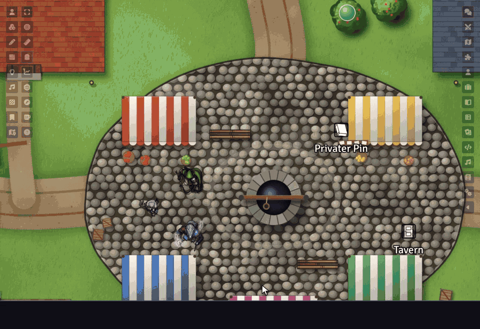

# Sephral’s Translator

**You speak a language that Sephral’s modules do not have yet? Translate a module in your own Foundry. Every word you type shows up at once in the real windows of the module, so you see how it fits.**

[](#install)
[](https://discord.gg/7BjCgDYaBP)
[](https://github.com/Sephral)



## Highlights

* **See it while you type:** the module’s windows, settings, token controls and chat cards change with every letter. Nothing reaches other players unless you choose so.
* **Every text in its place:** windows that need a fight, photos or votes open as sample windows with made-up data, so you see each text where it belongs without playing a session first.
* **Made for people, not for programmers:** click any text in a window to translate it, Ctrl+Enter takes you to the next open one, and texts you translated before are offered again. Placeholders (bits like {count} that Foundry fills in) are buttons, so you never type them.
* **Mistakes show at once:** a missing placeholder, a stray tag or a far too long text is flagged.
* **Your work stays yours:** drafts stay in your browser, changed English texts show next to your old translation, and you can export a language file any time.
* **Submit it where you are anyway:** one click saves a file, copies a short message and opens Sephral’s Discord or the module’s GitHub page. Translator sends nothing itself.
* **Use it right away:** keep your translation in your own Foundry, or let the GM share it with everyone in the world.
* **Made by people:** every translation is written by hand. No machine translation or AI tools, not even for a draft.
* **Review built in:** a second reader sees your texts in the real windows and suggests wording. You take a suggestion with one click, and both names go into the credits if you want.

## How it works

1. Enable the module, then click **Open translator** in the module settings. Or type `/translate` in the chat.
2. Pick the module and your language from the list. Click a text on the left, or the crosshair and then any text in a window, and type your version on the right.
3. Click **Submit...** and post the file on Discord or GitHub, or click **Export** to keep it.

## Good to know

A few texts are fixed when Foundry starts. The translator marks them, you see them after a page reload. What you type only changes your own screen, and closing puts every text back, unless you pick *Always, in my Foundry* or, as GM, *For everyone in this world* in the *Use* menu.

## Install

Install it with this link, it is not in Foundry’s module search yet:

```text
https://github.com/Sephral/sephrals-translator/releases/latest/download/module.json
```

1. In Foundry’s setup screen open **Add-on Modules** and click **Install Module**.
2. Paste the link into **Manifest URL**.
3. Click **Install**, then enable the module in your world.

On The Forge use **Install From Manifest** in the Bazaar.


Foundry VTT 13 and 14 · any game system · English and German

## Learn more

The [manual](MANUAL.md) explains every button, the checks and the submit dialog. Questions? Join [Discord](https://discord.gg/7BjCgDYaBP), the translators meet there in their own channels, or see [all modules by Sephral](https://github.com/Sephral).

## License

See [LICENSE.md](LICENSE.md).
